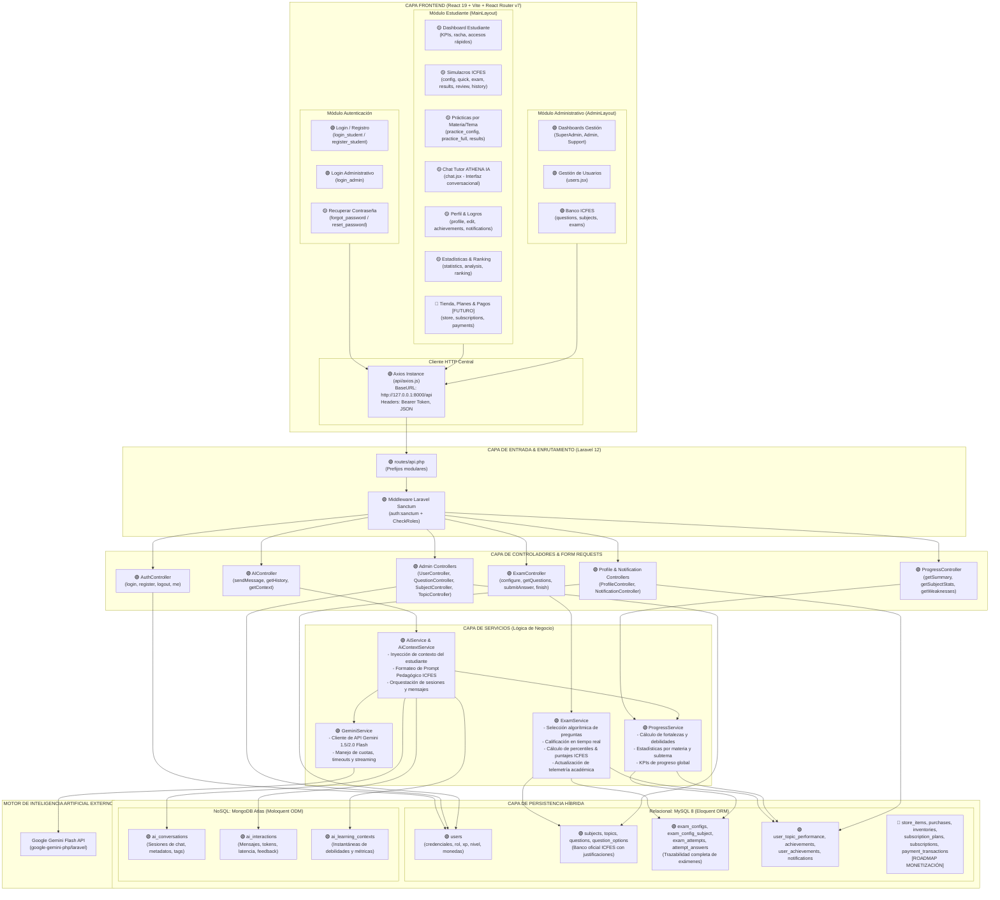
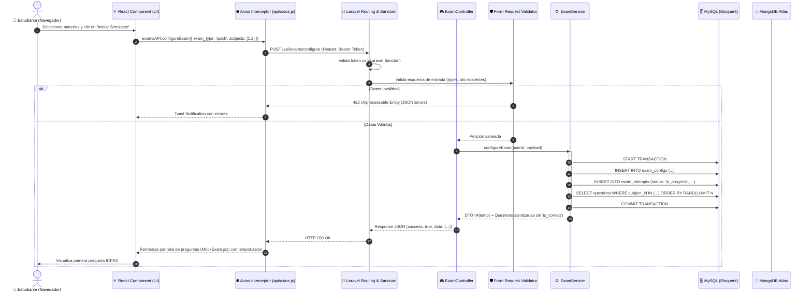
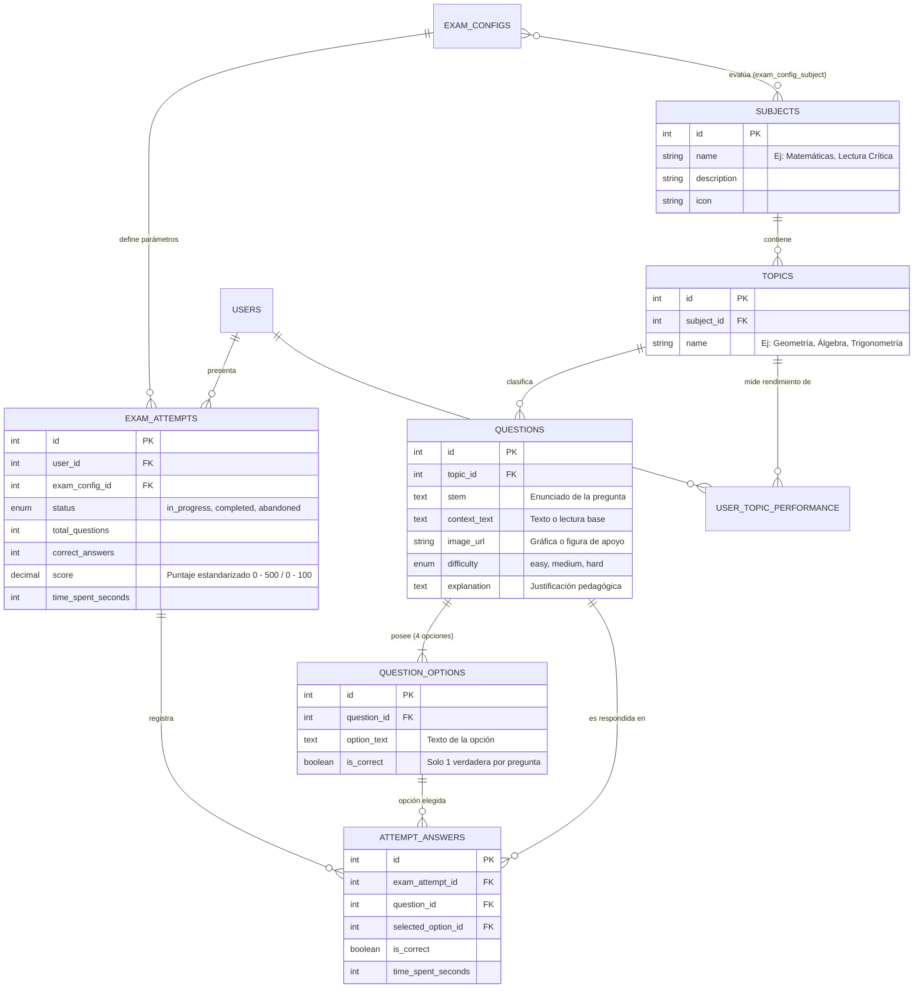
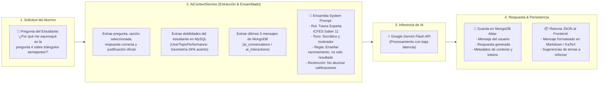

# Diagrama de Arquitectura Completo y Profundo — Proyecto ATHENA

**Versión:** 1.0  
**Fecha:** Octubre 2026  
**Sistema:** Plataforma Inteligente de Preparación para Pruebas Saber 11 (ICFES)  

---

## 1. Convenciones y Leyenda del Estado del Proyecto

Para reflejar con precisión tanto lo implementado como lo planificado, los diagramas y tablas utilizan la siguiente codificación visual y de estado:

* 🟢 **[COMPLETO / NÚCLEO ACTIVO]**: Funcionalidad, modelo, servicio o endpoint completamente implementado en el backend y estructurado.
* 🟡 **[EN INTEGRACIÓN / PARCIAL]**: Componente o vista de frontend en proceso de cableado con los endpoints de Axios / lógica en desarrollo.
* 🔵 **[ROADMAP / FASE FUTURA]**: Entidades de base de datos y modelos ya preparados en el código (ej. Tienda, Suscripciones, Pagos) que se activarán post-MVP.

---

## 2. Macro-Arquitectura Global del Sistema

Este diagrama ilustra la separación de responsabilidades en 5 capas: **Presentación (React)**, **Comunicación (Axios)**, **API & Negocio (Laravel 12)**, **Persistencia Híbrida (MySQL + MongoDB)** y **Servicios Cognitivos (Google Gemini IA)**.



---

## 3. Flujo Detallado de Datos: Petición ↔ Respuesta

Este diagrama de secuencia ilustra el ciclo de vida de una solicitud típica, desde que el usuario interactúa en la interfaz de React hasta la respuesta procesada.



---

## 4. Orquestación del Motor Académico y Simulacros ICFES

Cómo se relacionan las materias, los temas, el banco de preguntas y la evaluación del estudiante:



---

## 5. Arquitectura del Asistente Cognitivo: ATHENA IA

La inteligencia artificial no responde como un chatbot genérico; utiliza una **inyección contextual dinámica** basada en el desempeño real del estudiante:



---

## 6. Mapa Completo de Componentes de Frontend (React)

Estructura de la aplicación en React según las rutas y layouts definidos en `App.jsx`:

```
ATHENAreact/src/
│
├── App.jsx (Enrutador Principal con React Router v7)
│
├── components/
│   ├── MainLayout.jsx (🟢 Layout del Estudiante con Navbar + Sidebar + Topbar)
│   ├── AdminLayout.jsx (🟢 Layout de Gestión con Sidebar Administrativo y Role Guard)
│   ├── Sidebar.jsx (Navegación lateral con control activo)
│   ├── header/ (Componentes de cabecera, usuario y notificaciones)
│   └── footer/ (Pie de página institucional)
│
├── api/ (Capa de integración con Axios)
│   ├── axios.js (🟢 Instancia central con interceptores de Token y Errores)
│   ├── exams.js (🟢 Métodos para configurar, responder y finalizar simulacros)
│   ├── progress.js (🟢 Métodos para consultar métricas, estadísticas y resumen)
│   └── ai.js (🟢 Métodos para enviar mensajes a ATHENA y cargar historial)
│
└── pages/
    ├── authentications/
    │   ├── login_student.jsx (🟢 Inicio de sesión estudiante)
    │   ├── register_student.jsx (🟢 Registro de nuevo estudiante)
    │   ├── forgot_password.jsx (🟡 Recuperación de clave)
    │   └── reset_password.jsx (🟡 Restablecimiento de clave)
    │
    ├── admin/
    │   ├── login_admin.jsx (🟢 Acceso panel administrativo)
    │   ├── dashboard_super.jsx / dashboard_admin.jsx / dashboard_support.jsx (🟢 Paneles por rol)
    │   ├── users.jsx (🟢 Gestión de cuentas de usuario)
    │   ├── questions.jsx (🟢 CRUD Banco de Preguntas)
    │   ├── subjects.jsx (🟢 Gestión de Materias y Temas)
    │   └── exams.jsx (🟢 Auditoría de simulacros globales)
    │
    ├── dashboards/
    │   └── dashboard.jsx (🟡 Dashboard principal del estudiante)
    │
    ├── mock_exams/ (Módulo de Simulacros)
    │   ├── MockLayout.jsx (Sub-layout de examen)
    │   ├── mock_config.jsx (🟡 Configuración personalizada)
    │   ├── mock_quick.jsx (🟡 Simulacro rápido de 10-20 preguntas)
    │   ├── mock_exam.jsx (🟡 Interfaz interactiva de presentación)
    │   ├── mock_results.jsx (🟡 Hoja de resultados y puntaje)
    │   ├── mock_review.jsx (🟡 Revisión pregunta a pregunta con justificaciones)
    │   └── mock_history.jsx (🟡 Historial de todos los intentos)
    │
    ├── ai_tutor/
    │   └── chat.jsx (🟡 Chat interactivo con la tutora virtual ATHENA)
    │
    ├── practices/ (Modo práctica por materias)
    │   ├── practice_config.jsx / practice_full.jsx / practice_results.jsx
    │
    ├── profiles/ (Perfil del estudiante)
    │   ├── ProfileLayout.jsx
    │   ├── profile.jsx / profile_edit.jsx
    │   ├── profile_achievements.jsx (🟡 Sistema de logros y medallas)
    │   └── profile_notifications.jsx (🟡 Bandeja de avisos)
    │
    ├── statistics/ & ranking/
    │   ├── statistics.jsx / analysis.jsx (🟡 Gráficos de evolución y debilidades)
    │   └── ranking.jsx (🟡 Tabla de clasificación de estudiantes)
    │
    └── store/ & subscriptions/ (🔵 ROADMAP FUTURO)
        ├── store.jsx (Tienda de items / avatares con monedas virtuales)
        ├── subscription.jsx (Planes Premium de preparación)
        └── payments.jsx (Pasarela de pagos)
```

---

## 7. Matriz de Auditoría y Estado de Desarrollo

| Componente / Módulo | Capa Backend (Laravel) | Capa Frontend (React) | Persistencia | Estado General |
| :--- | :--- | :--- | :--- | :--- |
| **Autenticación (Sanctum)** | `AuthController.php`, Tokens, Middleware de roles | `login_student.jsx`, `register_student.jsx` | `users` (MySQL) | 🟢 **Funcional / En cableado final** |
| **Banco ICFES (Admin)** | `SubjectController`, `TopicController`, `QuestionController` | `subjects.jsx`, `questions.jsx`, `users.jsx` | `subjects`, `topics`, `questions`, `options` | 🟢 **Backend 100% / UI Operativa** |
| **Simulacros & Prácticas** | `ExamController.php`, `ExamService.php` | `mock_config.jsx`, `mock_exam.jsx`, `mock_results.jsx` | `exam_attempts`, `attempt_answers` | 🟡 **Lógica completa / UI en integración** |
| **Estadísticas y Progreso** | `ProgressController.php`, `ProgressService.php` | `statistics.jsx`, `analysis.jsx`, `dashboard.jsx` | `user_topic_performance` | 🟡 **Servicios de cálculo listos / Integrando gráficos** |
| **ATHENA IA Tutor** | `AIController.php`, `AiService.php`, `GeminiService.php` | `ai_tutor/chat.jsx` | MongoDB Atlas + MySQL + Gemini API | 🟢 **Backend Conectado / UI enlazando stream** |
| **Gamificación & Perfil** | `ProfileController.php`, `NotificationController.php` | `profile.jsx`, `profile_achievements.jsx` | `achievements`, `user_achievements` | 🟡 **Modelos y tablas creados / Vistas maquetadas** |
| **Tienda, Planes y Pagos** | Modelos y migraciones listos en BD | `store.jsx`, `subscription.jsx`, `payments.jsx` | `store_items`, `subscriptions`, `purchases` | 🔵 **Roadmap Futuro (Post-MVP)** |

---

## 8. Resumen Ejecutivo de la Arquitectura

1. **Desacoplamiento Estricto:** El Frontend (React) nunca se conecta directamente a la base de datos; toda operación transita mediante la API REST de Laravel con respuestas JSON estandarizadas.
2. **Garantía de Integridad:** La lógica evaluativa crítica (calificación, aleatoriedad del banco de preguntas, cálculo de puntajes ICFES y cálculo de fortalezas/debilidades) reside exclusivamente en los **Services** de Laravel, asegurando que el cliente no pueda alterar sus resultados.
3. **Persistencia Especializada:** MySQL garantiza la consistencia transaccional y relacional de exámenes y usuarios, mientras que MongoDB Atlas proporciona escalabilidad y flexibilidad para los historiales de conversación y telemetría de IA.
4. **Inteligencia Artificial Contextualizada:** ATHENA IA no responde de forma aislada; consume en tiempo real el historial y las debilidades del estudiante desde MySQL para ofrecer tutoría personalizada y socrática.
